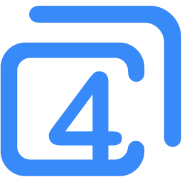
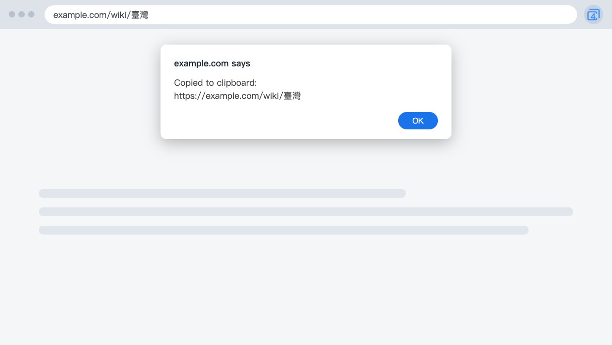

  

<h1 align="center">4cUrls</h1>

  <b>Copy URLs you can read.</b> 
  A small Chrome extension: readable Chinese, no tracking parameters, short YouTube links.

  English · <a href="README.zh-TW.md">繁體中文</a>

  

---

## What it is

Copy a Chinese URL from Chrome and paste it somewhere else, and you get a long run of percent signs. Click the 4cUrls icon instead, and what you paste is text you can read.

## Features

- **Readable Chinese URLs.** What you paste is text you can read.
- **No tracking parameters.** Removes `utm_*`, `fbclid`, `gclid` and similar parameters when a page opens.
- **Short YouTube links.** A video page copies as a `youtu.be` link.
- **English and Traditional Chinese.** It follows your browser's language.

Only want readable Chinese URLs? Try [4cUrls Lite](https://github.com/xxxxDev/4curls-lite), which leaves the address as it is.

## Install

Install from the [Chrome Web Store](https://chromewebstore.google.com/detail/ipfkfdlkklegfkepbopdfhogghpefkkb).

To load it yourself, download the zip from the [latest release](https://github.com/xxxxDev/4curls/releases/latest) and unzip it, or clone this repository. Open `chrome://extensions`, turn on **Developer mode**, choose **Load unpacked** and select the unzipped folder. In a clone, select the `extension` folder.

## Use it

1. Open the page you want to share.
2. Click the 4cUrls icon.
3. When the message appears, paste the URL wherever you need it.

The browser may ask once per site for permission to use the clipboard.

## Limits

- **Encoded characters that carry meaning stay encoded.** `%26` stays as it is, because a real `&` would change where the link goes. Spaces stay as `%20`.
- **Removing a parameter can affect a page.** 4cUrls removes only names used for tracking, plus some that are tracking on specific sites. If a page breaks, please open an issue.
- **It doesn't run on every page.** `chrome://` pages and the Chrome Web Store don't allow extensions to run. 4cUrls also skips Google Search and Google account pages.
- **A YouTube link keeps only the video.** The start time and playlist aren't copied.

## Privacy and permissions

4cUrls has no server and no analytics. It reads the address of the current page inside your browser, and it doesn't store it or send it anywhere. It runs a small script on the pages you open, and it writes to the clipboard only after you click the icon. See [SECURITY.md](SECURITY.md).

For questions about privacy, email [support@v-ax.com](mailto:support@v-ax.com).

## Contributing

To report a bug or suggest a change, see [CONTRIBUTING.md](CONTRIBUTING.md).

## License

The code is under the [MIT License](LICENSE). The icon isn't: see [BRAND.md](BRAND.md).

4cUrls is an independent project. It is not made by, affiliated with or endorsed by Google. Chrome is a trademark of Google LLC.

Made by [V-AX](https://v-ax.com).
