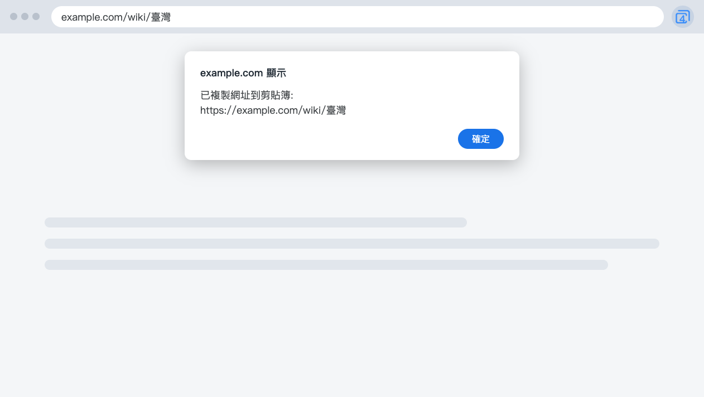

  

<h1 align="center">4cUrls</h1>

  <b>複製看得懂的網址。</b> 
  一個小小的 Chrome 擴充功能：中文好讀、拿掉追蹤參數、YouTube 短網址。

  <a href="README.md">English</a> · 繁體中文

  

---

## 這是什麼

從 Chrome 複製中文網址再貼到別處，會變成一長串百分比符號。改按 4cUrls 的圖示，貼上的就是看得懂的文字。

## 功能

- **中文網址好讀。** 貼上的是看得懂的文字。
- **拿掉追蹤參數。** 開頁面時移除 `utm_*`、`fbclid`、`gclid` 等參數。
- **YouTube 短網址。** 影片頁複製成 `youtu.be` 連結。
- **英文和繁體中文。** 依瀏覽器語言顯示。

只需要中文網址好讀？可以試試 [4cUrls Lite](https://github.com/xxxxDev/4curls-lite)，它不會動到網址。

## 安裝

從 [Chrome 線上應用程式商店](https://chromewebstore.google.com/detail/ipfkfdlkklegfkepbopdfhogghpefkkb)安裝。

想自己載入，可從[最新版本](https://github.com/xxxxDev/4curls/releases/latest)下載 zip 解壓縮，或複製這個 repo。打開 `chrome://extensions`，開啟**開發人員模式**，選**載入未封裝項目**，再選解壓縮後的資料夾。複製 repo 的話，選 `extension` 資料夾。

## 使用方式

1. 打開想分享的網頁。
2. 點 4cUrls 的圖示。
3. 看到提示後，到要用的地方貼上。

瀏覽器可能會針對每個網站詢問一次是否允許使用剪貼簿。

## 限制

- **有意義的編碼字元會保留。** `%26` 維持原樣，因為換成 `&` 會改變連結的去向。空格維持 `%20`。
- **拿掉參數可能影響網頁。** 4cUrls 只移除專門用來追蹤的名稱，以及在特定網站上用於追蹤的名稱。網頁不正常的話，請開 issue 回報。
- **不是每個頁面都會動作。** `chrome://` 和 Chrome 線上應用程式商店不允許擴充功能執行。4cUrls 也略過 Google 搜尋和 Google 帳戶頁面。
- **YouTube 連結只保留影片。** 開始時間和播放清單不會複製。

## 隱私

4cUrls 沒有伺服器，也沒有使用分析。它只在瀏覽器裡讀取目前網頁的網址，不會儲存，也不會傳到任何地方。詳見 [SECURITY.md](SECURITY.md)。

## 授權

程式碼採 [MIT 授權](LICENSE)。圖示不在此授權內，見 [BRAND.md](BRAND.md)。

由 [V-AX](https://v-ax.com) 製作。
